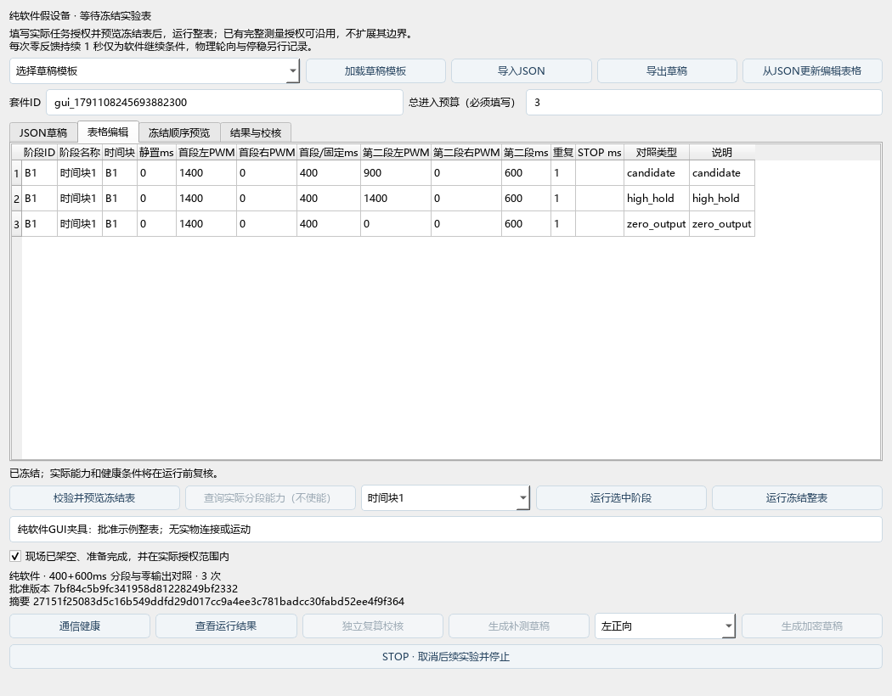

# 电机测量工作台 v0.6

2026-10-04。实施依据 [进一步电机测量功能需求](进一步电机测量功能需求_20261004.md) 和已批准计划，包括接收诊断、双端两段PWM、重复时间块、冻结整表、对照分析、加密草稿、补测与独立复算。PI、前馈和新增传感器留到后续。本轮未烧录或新测量；构建与软件验证见 [开发验收](电机测量开发验收_20261004.md)。

## 操作

1. 普通入口打开“电机测量工作台”；仅 `--automation` 开启MCP桥。软件验证使用 `启动假设备调试.bat`，不会访问实物。
2. 加载模板或导入JSON。填写实际授权范围内的PWM、方向和显式套件总进入预算。默认维持模板为四个轮侧/方向、三时间块，每条件候选/高PWM保持/PWM0对照各3次，共108试次；400ms启动加600ms第二段，后两块至少60秒静置，顺序预先交错/逆序/轮转。模板PWM和预算待填写。
3. 表格编辑立即同步JSON。直接改JSON后点击“从JSON更新编辑表格”。每次编辑使旧冻结版本失效。固定PWM只填首段列；填写第二段列切换为profile草稿。
4. 校验并预览冻结表，核对顺序、时长、重复、静置、停止条件和总数。显式预览分段表时准备查询实际能力，也可点击只读能力查询。匹配的PROFILE_CAPS与accepted ACK同时确认后才启用分段；旧固件拒绝查询时固定PWM仍可用。
5. 记录真实授权原话、现场准备条件，选择单阶段或整表运行。已有明确任务授权可复用，冻结表不能扩大其范围。软件零反馈持续1秒是继续条件，机械停稳另行观察。
6. STOP取消全部后续。中止后查看结果和取消槽位，点击“生成补测草稿”或自行编辑新表；补测有新阶段/时间块、原始来源、新冻结版本和新运行身份。已completed的有效零速失败不自动加入补测，不从原统计中删除。
7. 通信健康、运行结果、独立复算、加密草稿均在同一窗口。复算在后台写独立 `recompute.json`，原始文件保持。加密和补测仅生成草稿，须重新冻结后运行。



## v2草稿与预算

旧v1固定PWM表与产物保留兼容。每表最多16阶段、128试次；套件总进入预算1..4096，含对照、锚点、加密和补测。展开冻结表最多60KiB，桥消息64KiB；长说明需精简或拆表。固定PWM字段与 `segments` 互斥，profile正好两段、总时长不超过1000ms，同轮两段非零不得换向。以下仍是待填写草稿：

```json
{
  "schema_version": 2,
  "name": "单轮维持草稿",
  "suite": {"suite_id": "my_measurement", "total_entered_budget": null},
  "stages": [{
    "stage_id": "B1", "name": "时间块1", "block_id": "B1", "rest_before_ms": 0,
    "steps": [{
      "segments": [
        {"left_pwm": null, "right_pwm": 0, "duration_ms": 400},
        {"left_pwm": null, "right_pwm": 0, "duration_ms": 600}
      ],
      "repetitions": 3, "control_type": "candidate", "label": "待填PWM"
    }]
  }]
}
```

`control_type` 为 `candidate`、`high_hold`、`zero_output` 或固定 `fixed_pwm`。高PWM对照两段PWM必须相同；PWM0对照第二段两轮均0，保留全部轮速观察。可选 `stop_after_ms` 必须小于总时长；`origin_slot` 指向旧运行/试次。顺序预先展开，不根据实时成功率自动换档或重复。

套件索引在相应数据根的 `suites/<suite_id>/index.json`。已进入而中止的试次计入预算，未进入的取消槽位单列。未终结运行保留整表预算，防止进程崩溃后误用余额；不自动恢复。已有套件预算不可覆盖。余额不足只返回建议，不运行部分新表。

## 接收与健康

RX块ID在连接内递增，遥测保存帧序号及首末RX块。时刻对应底层读完、父端QProcess读完、worker入队、Controller开始/完成处理。父端读取不等于操作系统到达；缺失观测不补造。

协调入口先收取可读IPC，再按序解析与录制，最后判健康；上限64KiB输入、256事件及5ms处理预算，不等待或重入。活动实验遇到超预算积压、解析/传输/录制完整性失败或设备丢失变化即中止。原始采集时间保持，迟到/重放不能刷新年龄，500ms STATE与100ms真实分片门槛保持。日志与曲线100ms批量刷新，暂停、恢复和最小化继续接收录制。

健康窗口默认60秒、最多2048观测，显示年龄、各层p50/p95/max、tick/帧跳变及计数增量。重置建立新基线，保存旧当前计数及重置事件；观察者累计正增量不代表MCU绝对累计。停止面板区分排队、ACK处理、采集到的失能/PWM0、首次及连续零反馈；新动作结束未完成的旧停止窗口。旧记录未定位的阻塞点仍不能认定为唯一根因。

Host根据真实控制周期向下量化采集后经过时间，保守估计device tick，只计算一次deadline；MCU仍取接受tick+总时长与deadline的较早者。无线排队可能缩短实验，报告按实际证据分类，不续租。

## 分段分析

ACK只证明接受；命令seq、段号、起点和实际切换tick证明软件执行。相同PWM两段按段号区分。起步未成立、第二段未执行、观察不足、deadline截短、提前STOP与零速失败分别保存。

两段各至少4点、跨度不少于段时长减150ms且至少100ms、最大间隔100ms，并核对PWM和分段身份。兼容指标是尾4条至少3条同向；PWM0段仍按启动方向保留轮速。启动未成立时，不把第二段零反馈计为维持阈值失败。

同块、同连接/会话、同启动条件与段时长的候选、高PWM保持及PWM0各至少3次才作描述性对照。速度区间重叠标记“惯性未排除”；跨会话不计算tick差。结论限定600ms或实际记录窗口，不推出稳态、可靠启动或机械停车。

三时间块中相邻档全0/3与全3/3、没有混合、明显非单调或对照不足时，建议50PWM、再25PWM步长；包含端点锚点与两对照，全计入预算。漂移/不足时保持原档复测，不强制给单点阈值。

## 保存与复算

|产物|用途|
|---|---|
|telemetry.csv / communication.log|原始遥测、字节、录制完整性|
|receive_trace.jsonl|schema_version=1；RX/解析候选/健康判定/基线/停止/UI刷新|
|plan.json / context.json / events.jsonl|冻结表、原话/来源/范围、CAPS/RAM、实际静置与流程|
|results.csv / segments.csv / summary.json|试次、分段覆盖、每块分母、取消槽位|
|verification.json / recompute.json|独立CRC、CSV覆盖、字段及第二独立分类实现校核|
|report.md / speed_curve.svg|报告与分段device tick曲线，不跨会话连线|
|observations.jsonl / 套件index.json|观察来源、预算和补测身份|

独立校核不一致将运行标为失败，保留旧失败及原始数据。后补观察不改原报告。录制可能开始于握手之后，CAPS快照不能补造HELLO，本地BIN散列不证明当前实物固件。可离线只读复算：

```powershell
.\.venv\Scripts\python.exe scripts\recompute_measurement.py <运行目录> --no-save
```

审阅开发验收后，再安排新BIN烧录、扩展CAPS回读、同PWM/降PWM/PWM0输出、无线与本地停止及机械停车分别验收。新分段实车测量须先确认实物固件支持。
