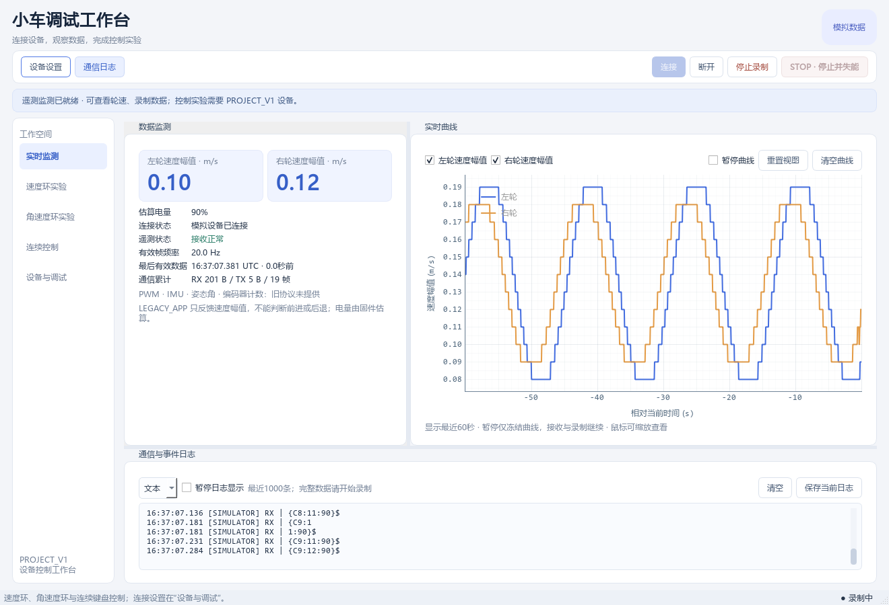

# 界面与操作优化

2026-11-03。重启上位机加载本次更新。

## 工作区与常用操作

- 宽度达到1240像素时使用侧边导航，较小窗口使用顶部标签；支持1000×720与1320×900窗口。
- Ctrl+1～5依次切换实时监测、速度环实验、角速度环实验、连续控制、设备与调试。切页沿用连续控制的STOP规则。
- 连接、断开、录制与STOP保留在顶部。状态提示区显示连接进度、等待设备状态或可进行的下一步，配置按钮只跳转设备设置。
- 浅色卡片、输入框、实验曲线与主操作统一样式；STOP使用红色。状态徽标区分未连接、真实连接和模拟数据。

## 监测与连续控制

- “通信日志”可收起或展开日志，接收与录制继续。该按钮只在监测页显示。
- “重置视图”恢复最近60秒和自动纵轴，保留历史数据；“清空曲线”仍用于清除曲线数据。
- 连续控制显示能力确认、参数回读、IMU就绪、状态新鲜且本地允许四项条件，并在使能按钮提示尚缺条件。最终使能条件仍由原服务检查，包括在途请求与实验互斥。
- 小窗口通过滚动查看连续控制的全部操作和反馈。失焦、切页、关闭及空格STOP行为保持。

## 验证

使用注入链路、模拟设备及离屏界面检查，不连接实车。五个工作页分别在1000×720与1320×900生成截图，检查导航、参数表单和连续控制滚动布局；证据在`.qa/modern_ui/`。可用`scripts/verify_modern_ui.py`重新生成离线截图。

UI、连续控制、速度、角速度与启动专项82项通过。最终全量794项通过、1项跳过、4个子测试通过，保留1项既有`too_long`夹具失败：第二段1601ms沿用旧界限，当前上限为4000ms。

本次只调整上位机，设备协议、控制算法、自动连接策略与参数持久化规则保持。
